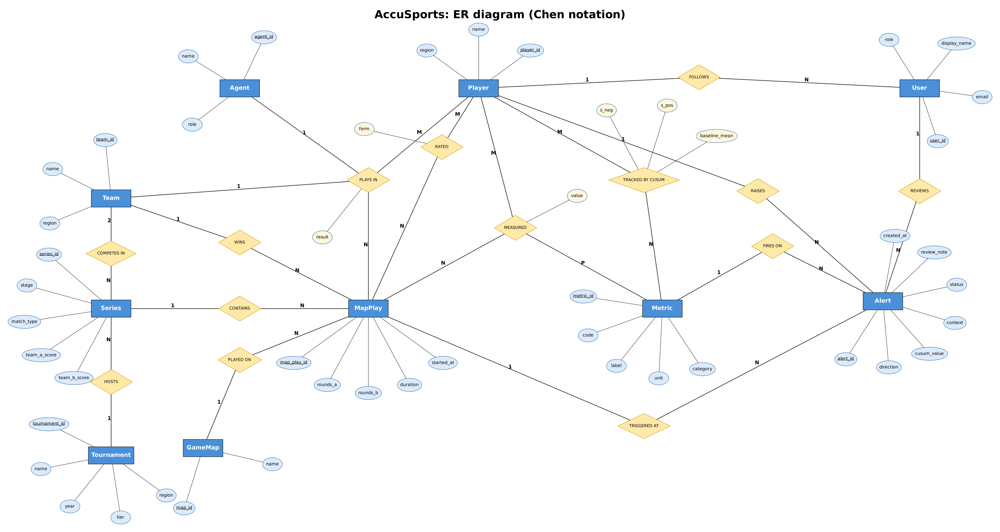

# AccuSports

**Early warning of performance decline for Valorant pro players.**

- Real VCT match data (2023 to 2026) goes into **PostgreSQL**.
- A **CUSUM detector runs as a database trigger** on every player's per-map stats. It flags a sustained decline before it shows in the player's form, and labels whether a roster move or role change was happening.
- **Qdrant** stores a 4-number playstyle fingerprint per player, for "who plays like this pro?" search.
- A **Next.js** web app with role-based login shows the dashboards, player pages, a moderator alert queue and an admin page.

Team: Rahul Saran Sharma (PES1UG24AM218), Ayush (PES1UG24AM909). DBMS Experiential Learning, Level 3.

## ER diagram



Standard (Chen) notation: rectangles are entities, diamonds are relationships, ovals are attributes (underlined = key), and the 1 / N / M labels give the cardinality. The 10 entities map to the 14 PostgreSQL tables: the many-to-many relationships PLAYS IN, MEASURED, RATED and TRACKED BY CUSUM become `map_participants`, `participant_metrics`, `form_ratings` and `cusum_state`. A table-level (schema) version with every column and foreign key is in `db/er-diagram.png`; the DDL is in `db/01_schema.sql`.

## Project layout

```
db/01_schema.sql          14 tables, constraints, indexes
db/02_cusum.sql           CUSUM + form triggers, fn_alert_context, fn_record_map
db/03_reports.sql         helper views, 12 report views, leaderboard, fingerprint view
db/demo.sql               queries for the live demo (run one at a time in pgAdmin)
data/vct/<year>/          VCT CSVs (Kaggle dataset of vlr.gg stats), see SOURCE.md
scripts/setup-db.mjs      build everything: schema, metric definitions, app accounts, VCT import
scripts/import-vct.mjs    VCT importer (re-runnable, skips maps already imported)
scripts/seed.mjs          metric definitions + web app accounts (no match data)
scripts/sync-qdrant.mjs   copy fingerprints from Postgres into Qdrant
scripts/similar-players.mjs  "who plays like X?" from the command line
lib/                      shared server code: db pool, auth, Qdrant, report list
app/                      Next.js pages and API routes
components/               React components (tables, charts, panels)
middleware.js             login + role checks for every page
```

## Setup (Windows, about 15 minutes)

1. Install **Node.js 18+** and **PostgreSQL 17** (keep pgAdmin; remember the `postgres` password and port).
2. Unzip the Qdrant Windows release into `tools/qdrant/`. Then start it and keep the terminal open:

```powershell
.\tools\qdrant\qdrant.exe
```

3. Copy `.env.example` to `.env.local`. Fill in the password and port in `DATABASE_URL`, and set `NEXTAUTH_SECRET` to a long random string.
4. Install, build the database (about 45 seconds), fill Qdrant, and build the app:

```bash
npm install
```

```bash
npm run setup-db
```

```bash
npm run sync-qdrant
```

```bash
npm run build
```

```bash
npm run start
```

5. Open http://localhost:3000.

## Logins (web app demo accounts, created by `scripts/seed.mjs`)

All use the password `password123`:

| Email | Role | Can use |
|---|---|---|
| admin@accusports.test | admin | everything, including the Admin page |
| mod1@accusports.test, mod2@accusports.test | moderator | dashboards, players, teams, Alert queue |
| analyst1@accusports.test, analyst2@accusports.test | analyst | dashboards, players, teams (read only, plus following a player) |

Passwords are stored as bcrypt hashes. Change or delete these accounts on the Admin page.

## Data

Real data only: 4,096 maps, 1,609 series, 618 players, 79 teams and 50 tournaments, from VCT 2023 to 2026 (2026 runs through Masters London). See [data/vct/SOURCE.md](data/vct/SOURCE.md).

Source: Ryan Luong. (2026). Valorant Champion Tour 2021-2026 Data [Dataset]. Kaggle. https://doi.org/10.34740/KAGGLE/DS/4448489 (scraped from VLR.gg).
